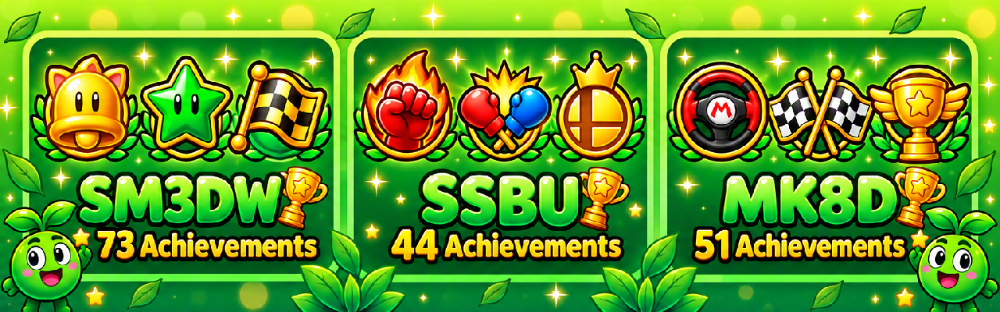

### The first unofficial achievement system for the Nintendo Switch

**[Website](https://jhondydario.github.io/Greeny/)** ·
**[Download](https://github.com/JhondyDario/Greeny/releases/latest)** ·
**[Games](https://jhondydario.github.io/Greeny/#/juegos)** ·
**[Discord](https://discord.gg/4KU8C9bEHy)** ·
**[Support the project](https://jhondydario.github.io/Greeny/#/contribuir)**

<!-- SCREENSHOTS: pop-up in game + the app (to be added) -->

---

## What is Greeny?

Play your games as usual and Greeny lets you know **the moment you earn an achievement**, with a pop-up and a sound. Collect points, level up, earn badges and compare yourself with friends and players around the world.

## Features

- 🏆 **Achievements while you play**, with bronze, silver and gold medals.
- 📱 **The Greeny app** on your Switch: your games, achievements, progress, profile, badges and play time.
- 🌍 **Online profile and rankings**: link your console, follow your friends and climb the worldwide, country and friends leaderboards.
- 💬 **Comments** on every supported game.
- 🎮 **In-game view** through Tesla (optional).
- 🌗 Spanish and English, light and dark themes, music and sounds.

## Supported games

New games are added regularly. See the **[Games](https://jhondydario.github.io/Greeny/#/juegos)** page for the full list and the status of each one.

## Installation

1. Download the latest **`greeny-x.y.z.zip`** from **[Releases](https://github.com/JhondyDario/Greeny/releases/latest)**.
2. Extract it to the **root of your SD card**.
3. Restart the console and open **Greeny** from the homebrew menu.

The app **updates itself** when a new version is available.

> **Requirements:** a Nintendo Switch running Atmosphère.

## FAQ

<b>Does Greeny change my games or save files?</b>

No. Greeny only watches what happens while you play. It never changes your games or your saves.

<b>Do I need an account?</b>

Not to play. An account is only needed for your online profile, the rankings, comments and following friends.

<b>Can I play online with Greeny?</b>

Greeny itself works offline and online. Keep in mind that using Nintendo's online services on a console with custom firmware always carries a risk of a ban, with or without Greeny. Many players use a separate setup for homebrew (emuMMC).

<b>My game is not supported yet. Can I help?</b>

Yes! Join the <a href="https://discord.gg/4KU8C9bEHy">Discord</a> to become a tester for new games.

## Community

- 💬 **[Discord](https://discord.gg/4KU8C9bEHy)** – news, help and game testing.
- 🌐 **[Website](https://jhondydario.github.io/Greeny/)** – profiles, rankings and comments.

## Support the project

Greeny is free and made by one person in their spare time. If you enjoy it, you can help keep it going:

Donations are optional and do not unlock achievements or give any advantage.

## License

Greeny is free for personal use. © Jhondy Dario. All rights reserved. See [LICENSE](LICENSE).

The Tesla overlay source code is published with each release under GPL-2.0. Third-party components: [THIRD_PARTY_NOTICES.md](THIRD_PARTY_NOTICES.md).

Greeny is a fan project. It is not affiliated with, endorsed or sponsored by Nintendo. All trademarks belong to their respective owners.
