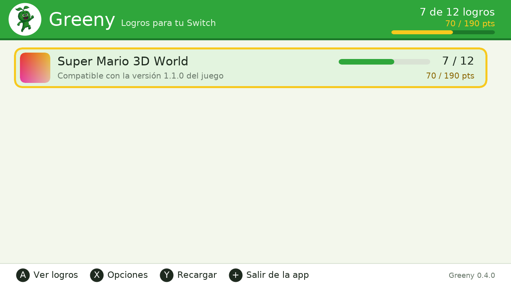
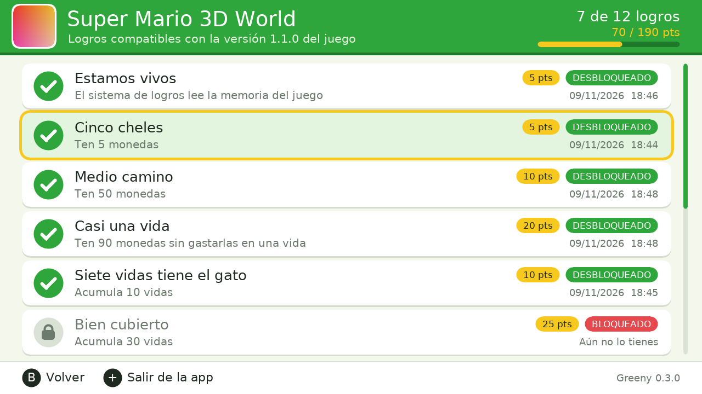
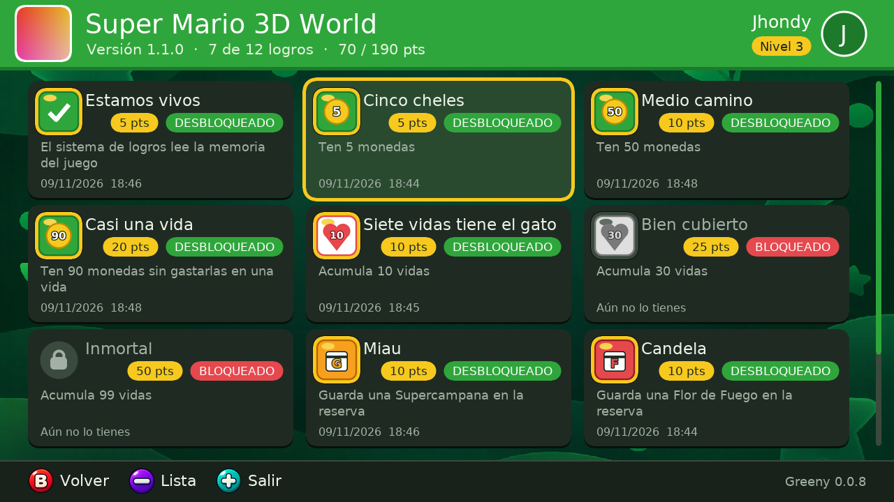
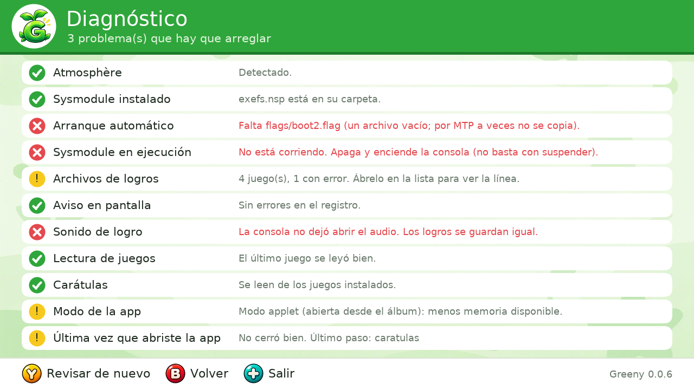

# Greeny

El primer sistema de logros no oficial para la Switch.

Greeny corre en segundo plano mientras juegas, lee la memoria del juego y, cuando
cumples las condiciones de un logro, lo guarda, te avisa en pantalla y suena. Los
logros de cada juego se definen en un archivo de texto, así que cualquiera puede
crear los de su juego favorito.

> Proyecto de fans. No está afiliado ni avalado por Nintendo. Requiere una
> consola con Atmosphère. **No lo uses en línea.**






*Capturas renderizadas en PC; en la consola se usa la fuente del sistema y la
carátula real del juego.*

## Qué trae

| Parte | Qué hace |
|---|---|
| **Sysmodule** (`source/`) | Detecta el juego, lee su memoria por `dmnt:cht`, desbloquea logros, muestra el aviso y reproduce el sonido. |
| **App Greeny** (`app/`) | Lista tus juegos con carátula, progreso y puntos; muestra cada logro, cómo se consigue y si ya lo tienes. Español e inglés, tema claro y oscuro, fondo animado, vista de lista o cuadrícula (se cambia con −), opciones por pestañas (L y R), sonidos, introducción de primera vez, cuenta opcional para subir tus logros a la web y una pantalla de diagnóstico. |
| **Motor** (`common/`) | Formato de logros y evaluación de condiciones. Portable: se prueba en PC. |
| **Web** (`web/`) | Perfiles, progreso, rareza de cada logro, vincular consola y página de desarrollador para publicar juegos. Se publica en GitHub Pages. |
| **Logros** (`juegos/`) | Un archivo por juego. Por ahora: Super Mario 3D World + Bowser's Fury v1.1.0 (12 logros). |

## Instalar

1. Descarga `greeny.zip` y descomprímelo en la raíz de la tarjeta SD. También
   vale copiar solo `switch/greeny.nro`: al abrirla, la app instala el sysmodule
   y los sonidos, y con internet baja los logros de los juegos que tengas.
2. Reinicia la consola (apagar y encender, no suspender).
3. Abre un juego que tenga logros: sale el aviso "LOGROS ACTIVOS".
4. Abre **Greeny** desde el menú de homebrew para ver tu progreso.

```
atmosphere/contents/4200000000010690/   sysmodule
switch/greeny.nro                       app
config/greeny/games/                    archivos de logros, uno por juego
config/greeny/unlocked/                 tu progreso
config/greeny/sounds/                   sonidos que usa el sysmodule
config/greeny/account.ini               llave de esta consola, si la vinculaste (no es tu contraseña)
config/greeny/cache/                    iconos de logros ya descargados
config/greeny/config.ini                opciones
config/greeny/log.txt                   registro del sysmodule
config/greeny/app-log.txt               pasos de arranque de la app
```

## Si algo no funciona

Abre **Greeny → Opciones (X) → Diagnóstico**. Revisa que el sysmodule esté
instalado y corriendo, que los archivos de logros no tengan errores y qué dijo
el sysmodule la última vez (aviso, sonido, versión del juego).

Si la app se congela al abrir, `config/greeny/app-log.txt` dice cuál fue el
último paso que alcanzó.

Al abrir un juego, Greeny avisa en pantalla si sus logros quedaron activos o si
no van a funcionar (versión distinta del juego, archivo con error o no se pudo
leer la memoria).

Si venías de una versión anterior (`config/logros`), tu progreso se pasa solo a
`config/greeny` la primera vez. Puedes borrar `switch/logros.nro` y `switch/gree.nro`.

Para desinstalar, borra `atmosphere/contents/4200000000010690/`. Si la consola no
arranca tras instalar, saca la SD y borra esa carpeta desde la PC.

## Crear logros para un juego

Guía completa en [docs/CREAR-LOGROS.md](docs/CREAR-LOGROS.md). En corto:

```ini
game    = Mi Juego
version = 1.1.0
build   = 3CA12DFAAF9C82DA

[monedas_100]
name    = Bolsillo lleno
desc    = Junta 100 monedas
name.en = Full pockets
desc.en = Collect 100 coins
points  = 10
when    = main+0x1A2B3C40 u32 >= 100
```

El archivo va en `config/greeny/games/<TITLE ID>.txt`.

## Compilar

Hace falta devkitA64 + libnx (con `switch-freetype`), o Docker:

```bash
docker run --rm -v "$PWD":/src -w /src devkitpro/devkita64 make
```

```bash
docker run --rm -v "$PWD":/src -w /src devkitpro/devkita64 make -C app
```

```bash
./scripts/dist.sh
```

Eso deja `dist/` y `greeny.zip` con la estructura de la SD.

Pruebas del motor en PC (no hace falta consola):

```bash
make -C test
```

## Estado

| Función | Estado |
|---|---|
| Lectura de memoria, desbloqueo, guardado | Probado en consola |
| Aviso en pantalla y sonido | Probado en consola (con el sonido generado; los sonidos nuevos faltan por probar) |
| Avisos de "logros desactivados" al abrir un juego | Falta probar en consola |
| Logros de Mario 3D World 1.1.0 | Probados en consola |
| Buscador de punteros (`scan`) | Probado en consola |
| App: interfaz gráfica, idiomas, opciones, carátulas | Revisada en PC; falta probarla en consola |
| App: tema oscuro, cuadrícula, diagnóstico, sonidos, fondo animado | Revisada en PC; falta probarla en consola |
| App: introducción de primera vez, saludo y Acerca de | Revisada en PC; falta probarla en consola |
| Base de datos (Supabase) | Esquema listo y probado en Postgres ([docs/SUPABASE.md](docs/SUPABASE.md)) |
| Web con cuentas (`web/`) | Hecha; probada en navegador con servidor simulado, falta contra el proyecto real |
| App: cuenta (vincular con código, entrar con correo, subir logros) | Probada contra el servidor real desde PC; falta probarla en consola |
| Perfil, nivel, medallas y seguidores (app y web) | Revisado en PC y en navegador; falta probarlo en consola y contra el servidor real |
| Iconos de logros en la app (se bajan del catálogo y se guardan en la SD) | Descarga probada contra el servidor real desde PC; falta probarla en consola |
| Código de amigo y soporte táctil en la app | Falta probarlos en consola |
| App: instala el sysmodule y baja los logros de los juegos instalados | Descarga probada contra el servidor real desde PC; falta probarlo en consola |
| Web: página Desarrollador (datos y estado del juego, frases), foto de perfil | Probada en navegador con servidor simulado |
| Foto de perfil en la app (verla y cambiarla desde la SD) | Pendiente |
| Buscador de juegos del catálogo en la app | Pendiente |
| Iconos por logro, música y animaciones en la app | Pendiente ([docs/RECURSOS.md](docs/RECURSOS.md)) |

## Limitaciones que conviene saber

- Las direcciones de memoria cambian con cada versión del juego. Cada archivo de
  logros sirve para una versión concreta; si no coincide, Greeny desactiva esos
  logros en vez de leer datos equivocados.
- Greeny mira el estado del juego, no cómo llegaste a él. Con un cheat se puede
  desbloquear un logro. No es un sistema anti-trampas.
- Al engancharse a un juego, `dmnt` queda como depurador, igual que con los
  cheats de Atmosphère.

## Licencia y créditos

GPLv2 (ver [LICENSE](LICENSE)). Incluye código derivado de
[Atmosphère](https://github.com/Atmosphere-NX/Atmosphere) (`dmntcht`) y sigue el
procedimiento de capa de [libtesla](https://github.com/WerWolv/libtesla), ambos
GPLv2. Fuente del aviso: [font8x8](https://github.com/dhepper/font8x8) (dominio
público). Carga de imágenes: [stb_image](https://github.com/nothings/stb)
(dominio público). La mascota y el nombre Greeny son de Jhondy.
