

# Greeny Achievements

### The first unofficial achievement system for the Nintendo Switch

**[Website](https://jhondydario.github.io/Greeny/)** ·
**[Download](https://github.com/JhondyDario/Greeny/releases/latest)** ·
**[Games](https://jhondydario.github.io/Greeny/#/juegos)** ·
**[Discord](https://discord.gg/4KU8C9bEHy)** ·
**[Support the project](https://jhondydario.github.io/Greeny/#/contribuir)**

 

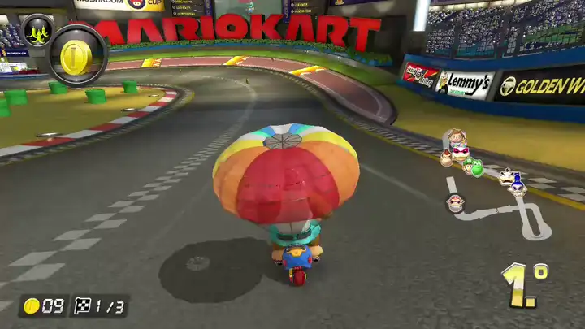 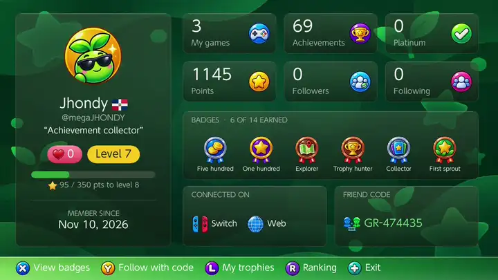

---

## What is Greeny?

Play your games as usual and Greeny lets you know **the moment you earn an achievement**, with a pop-up and a sound. Collect points, level up, earn badges and compare yourself with friends and players around the world.

## Features

- 🏆 **Achievements while you play**, with bronze, silver and gold medals.
- 📱 **The Greeny app** on your Switch: your games, achievements, progress, profile, badges and play time.
- 🌍 **Online profile and rankings**: link your console, follow your friends and climb the worldwide, country and friends leaderboards.
- 💬 **Comments** on every supported game.
- 🎮 **In-game view** through Tesla (optional): check your achievements and progress without leaving the game.
- 🌗 Spanish and English, light and dark themes, music and sounds.

## Screenshots

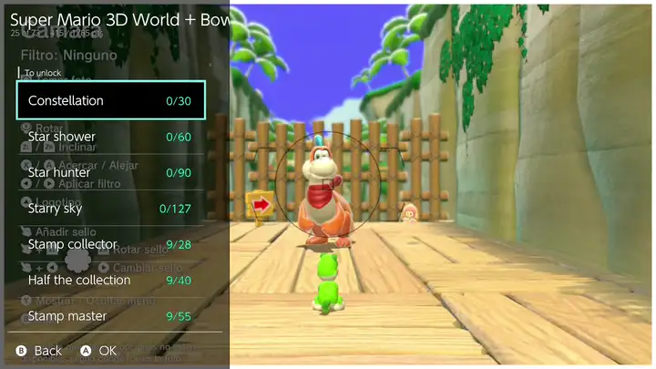 <b>Greeny in Tesla</b> – browse your achievements and your progress on each one in the middle of a game.

<table>
  <tr>
    <td width="50%">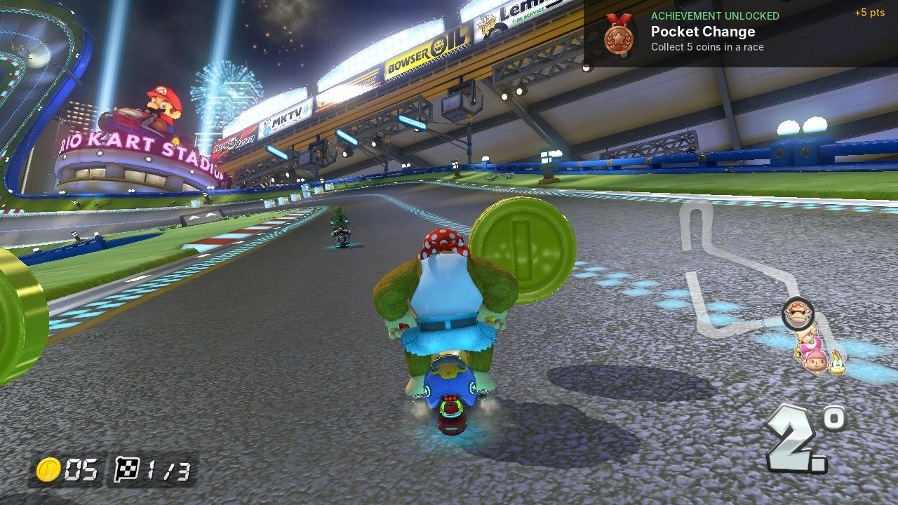 <b>Achievement unlocked</b> – a pop-up and a sound the moment you earn it.</td>
    <td width="50%">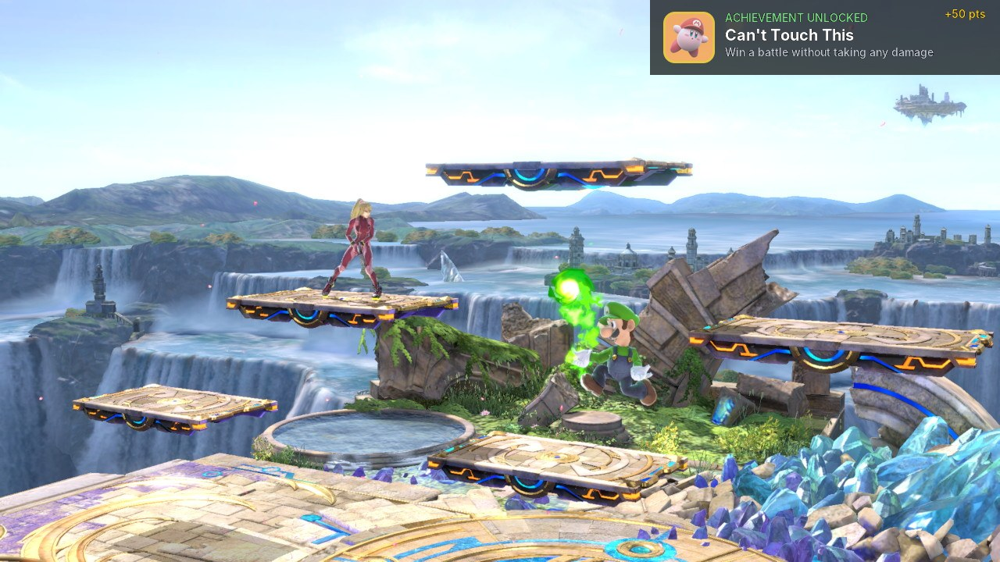 <b>Bronze, silver and gold</b> – harder achievements give more points.</td>
  </tr>
  <tr>
    <td width="50%">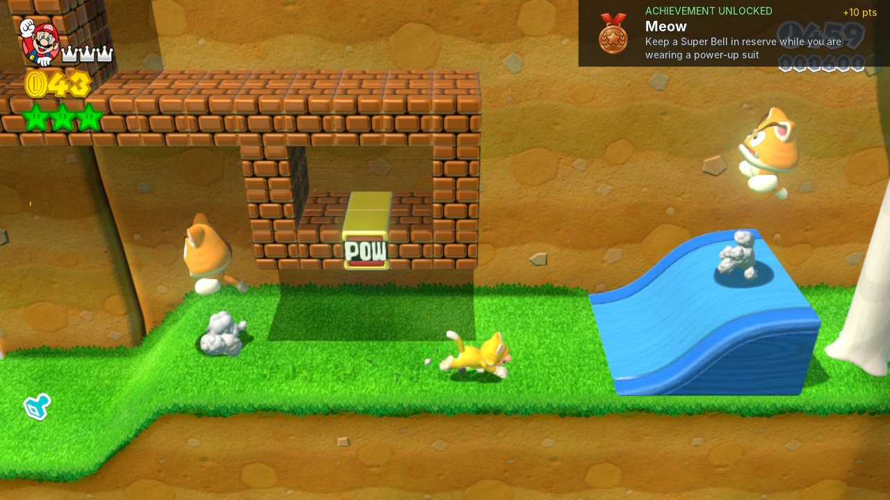 <b>Made for each game</b> – achievements built around what you actually do in the game.</td>
    <td width="50%">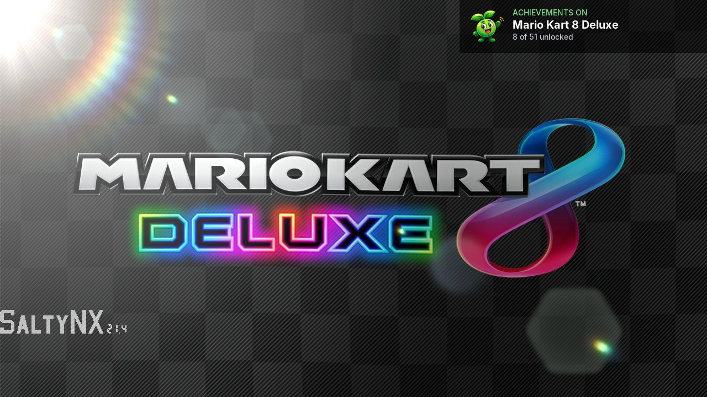 <b>Achievements on</b> – Greeny tells you it is ready when the game starts.</td>
  </tr>
  <tr>
    <td width="50%">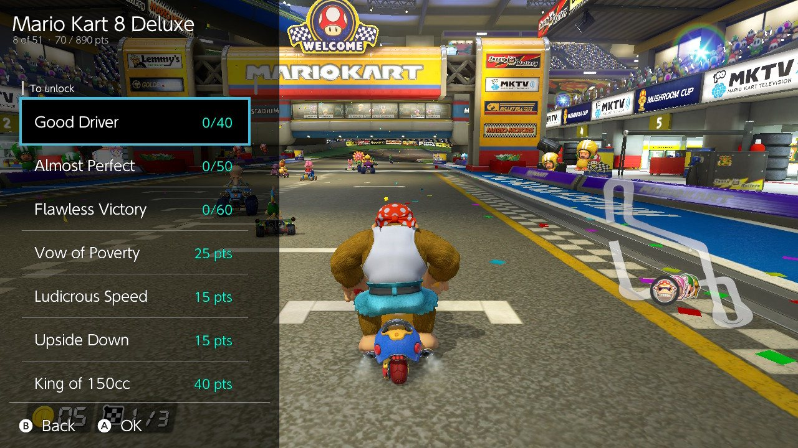 <b>Check them mid-game</b> – open Tesla, pick Greeny and see what is left without leaving the game.</td>
    <td width="50%">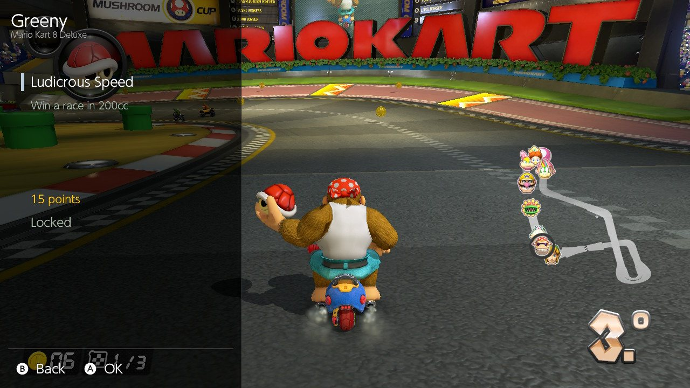 <b>Every detail</b> – how to earn it, its points and whether you have it.</td>
  </tr>
  <tr>
    <td width="50%">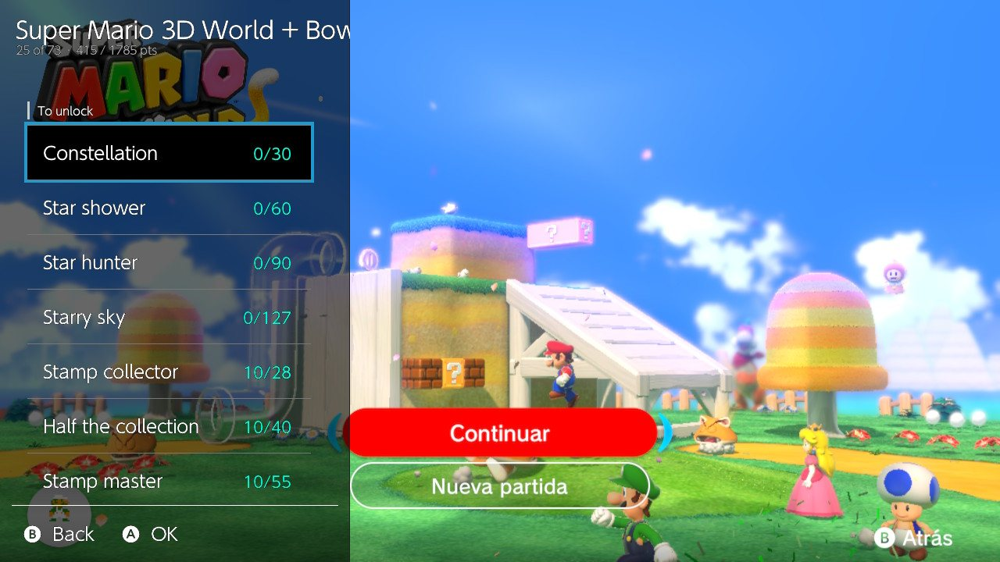 <b>Live progress</b> – see how far you are, like 10 of 28 stamps.</td>
    <td width="50%">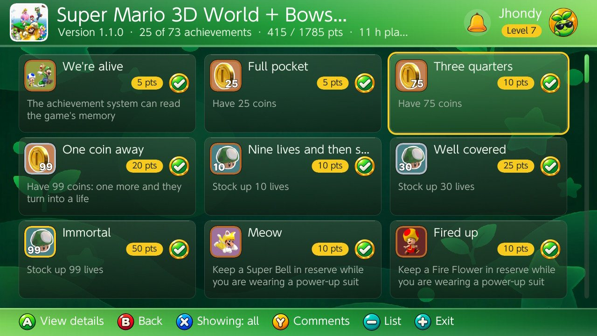 <b>Every achievement</b> – medals, points and your progress on each one.</td>
  </tr>
  <tr>
    <td width="50%">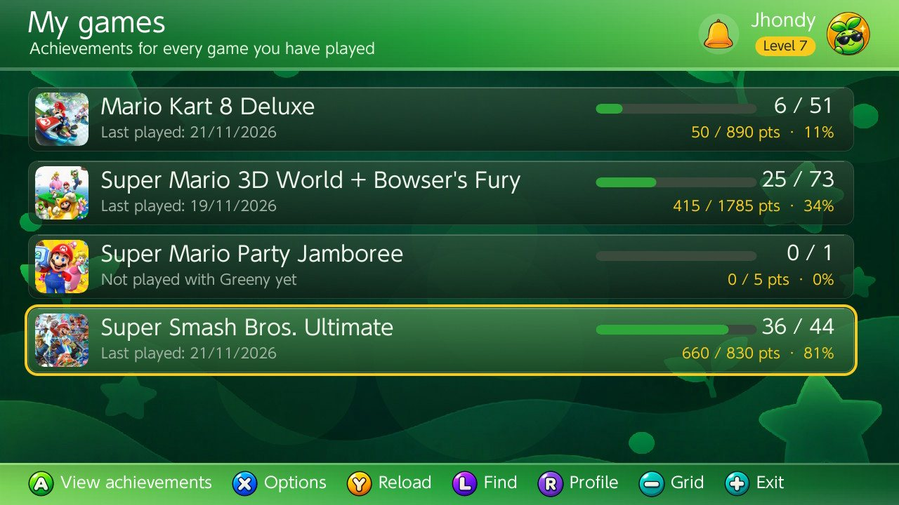 <b>My games</b> – your progress in every game you have played.</td>
    <td width="50%">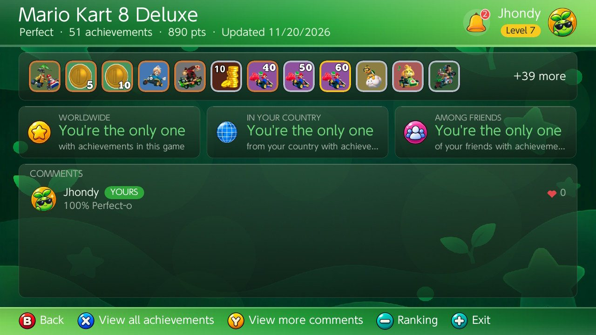 <b>Game page</b> – how you rank worldwide, in your country and among friends.</td>
  </tr>
  <tr>
    <td width="50%">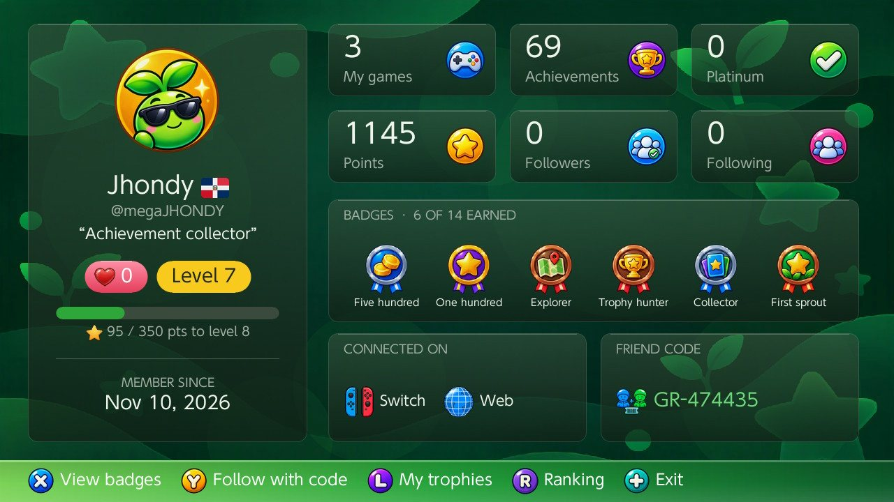 <b>Your profile</b> – level, points, badges and friend code.</td>
    <td width="50%">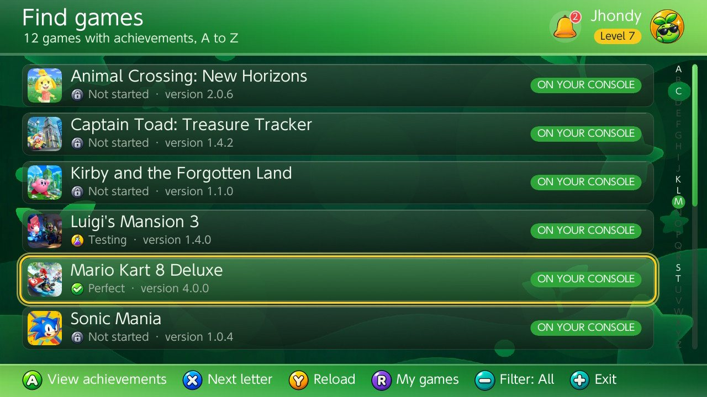 <b>Find games</b> – see which of your games already have achievements.</td>
  </tr>
</table>

## Supported games

<table>
  <tr><th>Game</th><th>Achievements</th></tr>
  <tr><td>Super Mario 3D World + Bowser's Fury</td><td align="center">76</td></tr>
  <tr><td>Mario Kart 8 Deluxe</td><td align="center">54</td></tr>
  <tr><td>Super Smash Bros. Ultimate</td><td align="center">47</td></tr>
  <tr><td>Super Mario Bros. Wonder</td><td align="center">36</td></tr>
</table>

New games are added regularly. See the **[Games](https://jhondydario.github.io/Greeny/#/juegos)** page for the full list and the status of each one.

## Roadmap

- 🤝 Group achievements to earn together with your friends.
- 🎮 Many more achievements in many more games.
- 🔥 Hardcore achievements.
- 🌐 Achievements for playing online, compatible with [Nextendo Network](https://github.com/NextendoNetwork).
- 🆕 Achievements for Switch 2 games.
- 📱 Android and iOS apps.
- 🏠 A dedicated domain for the website.
- ✨ And much more.

## Installation

1. Download the latest **`greeny-x.y.z.zip`** from **[Releases](https://github.com/JhondyDario/Greeny/releases/latest)**.
2. Extract it to the **root of your SD card**.
3. Restart the console and open **Greeny** from the homebrew menu.

The app **updates itself** when a new version is available.

> **Requirements:** a Nintendo Switch running Atmosphère.

## FAQ

<b>Does Greeny change my games or save files?</b>

No. Greeny only watches what happens while you play. It never changes your games or your saves.

<b>Do I need an account?</b>

Not to play. An account is only needed for your online profile, the rankings, comments and following friends.

<b>Can I play online with Greeny?</b>

Greeny itself works offline and online. Keep in mind that using Nintendo's online services on a console with custom firmware always carries a risk of a ban, with or without Greeny. Many players use a separate setup for homebrew (emuMMC).

Achievements for playing online are coming, and they will be compatible with [Nextendo Network](https://github.com/NextendoNetwork), a fan-made online service that does not use Nintendo's servers.

<b>My game is not supported yet. Can I help?</b>

Yes! Join the <a href="https://discord.gg/4KU8C9bEHy">Discord</a> to become a tester for new games.

**More technical questions** (RAM usage, homebrew games, emulators, Switch 2, save files): see the
**[Technical FAQ](FAQ.md)**.

## Community

<table>
  <tr>
    <td align="center" width="33%">
       
      News, help, game requests and testing.
    </td>
    <td align="center" width="33%">
       
      Profiles, rankings, comments and every supported game.
    </td>
    <td align="center" width="33%">
       
      Found a bug or an achievement that does not unlock? Tell us.
    </td>
  </tr>
</table>

## Support the project

Greeny is free and made by one person in their spare time. 
There are many ways to help, and most of them cost nothing.

<table>
  <tr>
    <td align="center" width="25%">⭐ <b>Star the repo</b> It helps more people find Greeny.</td>
    <td align="center" width="25%">📣 <b>Share it</b> Forums, Discord servers, friends.</td>
    <td align="center" width="25%">🎮 <b>Test games</b> Help us bring new games to Greeny. Ask on Discord.</td>
    <td align="center" width="25%">🐞 <b>Report achievements</b> From the app or the website, in one tap.</td>
  </tr>
</table>

 

 
<b>Donate and get the donor badge</b>

Write your Greeny username in the donation note. The badge shows on your profile, on the website and in the app. 
It is added by hand, so it can take a little while. It is only a badge: no achievements or ranking advantage.

## Integrations

Greeny is built to be extended. HOME menus, launchers, overlays and other homebrew can show Greeny achievements
— much like RetroAchievements lives inside many emulators while staying one project — as long as Greeny stays
the source and is credited as **"Achievements by Greeny"**. See [INTEGRATIONS.md](INTEGRATIONS.md) for what is
allowed and the files you can read.

## License

Greeny is free for personal use. © Jhondy Dario. All rights reserved. See [LICENSE](LICENSE).

The Tesla overlay source code is published with each release under GPL-2.0. Third-party components: [THIRD_PARTY_NOTICES.md](THIRD_PARTY_NOTICES.md).

Greeny is a fan project. It is not affiliated with, endorsed or sponsored by Nintendo. All trademarks belong to their respective owners.
