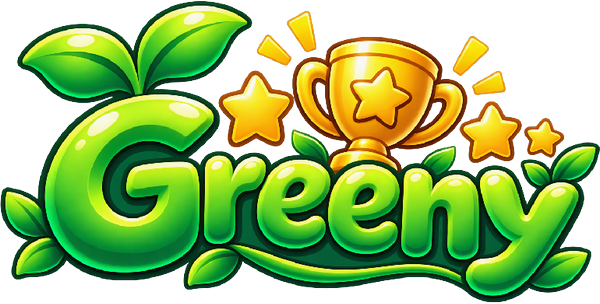

<b>The first unofficial achievement system for the Nintendo Switch.</b>

  <a href="https://jhondydario.github.io/Greeny/">Website</a> ·
  <a href="https://github.com/JhondyDario/Greeny/releases/latest">Download</a> ·
  <a href="https://discord.gg/4KU8C9bEHy">Discord</a>

---

Play your games as usual and Greeny lets you know the moment you earn an achievement, with a pop-up and a sound. Collect points, level up, earn badges and compare yourself with friends and players around the world.

## Features

- **Achievements while you play**, with bronze, silver and gold medals.
- **The Greeny app** on your Switch: your games, achievements, progress, profile and badges.
- **Online profile and rankings**: link your console, follow friends and climb the leaderboards.
- **Comments** on every supported game.
- **In-game view** through Tesla (optional).
- Spanish and English, light and dark themes.

## Installation

1. Download the latest **greeny-x.y.z.zip** from [Releases](https://github.com/JhondyDario/Greeny/releases/latest).
2. Extract it to the root of your SD card.
3. Restart the console and open **Greeny** from the homebrew menu.

The app updates itself when a new version is available.

**Requirements:** a Nintendo Switch running Atmosphère. Play offline when using custom firmware.

## Supported games

See the [Games](https://jhondydario.github.io/Greeny/#/juegos) page on the website for the full list and the status of each game.

## Contributing

Want to help test new games? Join the [Discord](https://discord.gg/4KU8C9bEHy) or visit the [Contribute](https://jhondydario.github.io/Greeny/#/contribuir) page.

## License

Greeny is free for personal use. © Jhondy Dario. All rights reserved. See [LICENSE](LICENSE).
The Tesla overlay source is published with each release under GPL-2.0. Third-party components: [THIRD_PARTY_NOTICES.md](THIRD_PARTY_NOTICES.md).

Greeny is a fan project. It is not affiliated with, endorsed or sponsored by Nintendo.
